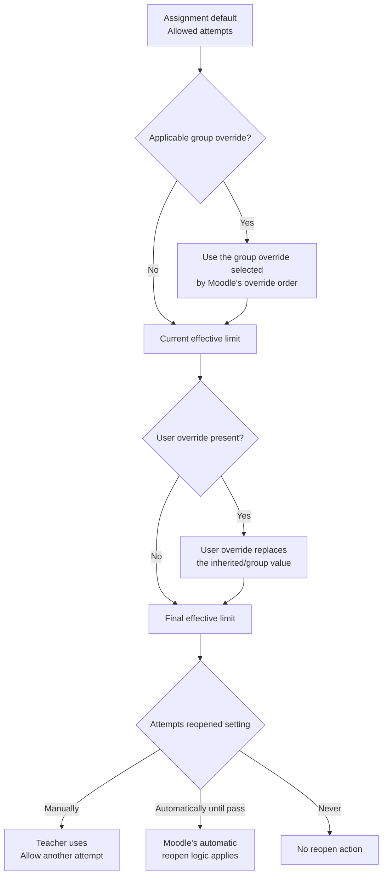
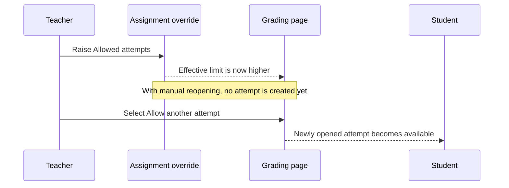

# Assignment override parity for allowed attempts

[](https://github.com/Portvgal/moodle-assign-override-parity/actions/workflows/ci.yml)

Moodle Assignment currently defines **Allowed attempts** at activity level but does not let teachers vary that limit through user or group overrides. [MDL-67322](https://tracker.moodle.org/browse/MDL-67322) adds an optional `Allowed attempts` value to Assignment overrides so Moodle can calculate and enforce an effective limit for each student.

> [!IMPORTANT]
> The authoritative implementation is the [active Moodle contribution branch](https://github.com/Portvgal/moodle/tree/MDL-67322-assign-override-maxattempts), which targets Moodle `main`. The patch files in this repository are historical snapshots for Moodle 4.5 and 5.2; they are not the current Tracker submission or current review evidence.

**Contribution links:** [MDL-67322](https://tracker.moodle.org/browse/MDL-67322) · [active branch](https://github.com/Portvgal/moodle/tree/MDL-67322-assign-override-maxattempts) · [patch validation CI](https://github.com/Portvgal/moodle-assign-override-parity/actions/workflows/ci.yml) · [Moodle 4.5 patch](patches/assign-override-maxattempts.patch) · [Moodle 5.2 patch](patches/assign-override-maxattempts-moodle52.patch)

## Contents

- [Before and after](#before-and-after)
- [Implementation overview](#implementation-overview)
- [How Moodle determines the effective limit](#how-moodle-determines-the-effective-limit)
- [Interaction with attempt reopening](#interaction-with-attempt-reopening)
- [Teacher workflows](#teacher-workflows)
- [Verification status](#verification-status)
- [Historical patch reference](#historical-patch-reference)

## Before and after

| | Before MDL-67322 | With MDL-67322 |
|---|---|---|
| Activity configuration | One `Allowed attempts` value applies to the assignment. | The activity value remains the default. |
| User override | Cannot vary the attempt limit. | May define an individual total attempt limit. |
| Group override | Cannot vary the attempt limit. | May define a total attempt limit for the selected group. |
| Grading actions | Availability is based on the activity-wide limit. | Availability is based on each student's effective limit. |
| Student result | Every student shares the same maximum. | A student can receive the activity default, a selected group value, or a user-specific value. |

The override value is the **total number of attempts allowed**, not the number of extra attempts to add.

For example, if the assignment allows 2 attempts and a user override allows 3, that student may make 3 attempts in total—not 5.

## Implementation overview

| Area | Implemented change |
|---|---|
| Database and upgrade | Adds nullable `maxattempts` to `assign_overrides`, including the Moodle upgrade step. A null value continues to inherit the activity setting; `-1` represents unlimited attempts. |
| Override forms | Adds `Allowed attempts` to both user and group override forms. |
| Effective access | Includes `maxattempts` when Moodle merges assignment defaults, applicable group overrides, and a user override. |
| Grading interface | Calculates attempt-action availability from the affected student's effective settings. |
| Individual reopening | Checks the effective limit before displaying or processing `Allow another attempt`. |
| Bulk reopening | Makes the bulk action available when at least one listed student has a compatible effective manual-reopening configuration. The action still validates each student individually. |
| Submission enforcement | Prevents Moodle from creating an attempt beyond the student's effective finite limit. |
| Backup and restore | Includes the override value in Assignment backup and restore structures. |
| Privacy | Includes the value when Assignment override data is exported through the privacy provider. |
| Upgrade documentation | Records the new override field and its behaviour in Moodle's upgrade notes. |
| Automated coverage | Adds focused PHPUnit and Behat coverage for user and group overrides, unlimited attempts, precedence, action visibility, persistence, and backup/restore behaviour. |

## How Moodle determines the effective limit



| Situation | Effective result |
|---|---|
| No applicable override | Assignment `Allowed attempts` value |
| One applicable group override | That group's value |
| Several applicable group overrides | The group override selected by Moodle's override ordering |
| User and group overrides both apply | User override |
| Override leaves the value unset | Inherited value |

Moodle does **not** automatically choose the most generous group value. If a student belongs to multiple overridden groups, the applicable value comes from the group override with the highest priority in the Group overrides list (the lowest sort order). A user override then takes precedence over the selected group value.

When a student needs a result different from their group, use a user override.

## Interaction with attempt reopening

Changing the maximum does not necessarily open another submission attempt. The `Attempts reopened` setting still controls how the next attempt is created.

| Attempts reopened | Does the override change the limit? | Does raising the limit immediately open an attempt? |
|---|---:|---:|
| `Manually` | Yes | No. A teacher must use `Allow another attempt`. |
| `Automatically until pass` | Yes | No immediate action. Moodle's normal automatic reopen logic decides when to create the attempt. |
| `Never` | The effective limit can be resolved, but no reopening workflow uses it. | No. |



## Teacher workflows

### Grant another attempt to one student

**Prerequisites**

- The assignment uses `Attempts reopened: Manually`.
- The student's effective `Allowed attempts` value is greater than their current attempt count.
- `Allow submissions from`, due date, and cut-off date permit the intended submission.

**Steps**

1. Create or edit the applicable user or group override.
2. Set `Allowed attempts` to the required total.
3. Check the override dates, especially the cut-off date.
4. Return to the student's submission or grading page.
5. Choose `Allow another attempt`.

**Expected result:** Moodle creates the next attempt and the student can submit it while the effective dates allow submission.

**If it fails:** Check that manual reopening is enabled, the current attempt has not already been reopened, the effective limit has not been exhausted, and the cut-off date has not passed.

### Grant another attempt to several students

**Prerequisites**

- Create the relevant user or group overrides before using the bulk action.
- The selected students have compatible effective limits and submission dates.
- The assignment uses manual reopening.

**Steps**

1. Open `View all submissions`.
2. Select the affected students.
3. Open `More` in the sticky footer toolbar.
4. Choose `Allow another attempt`.

**Expected result:** Moodle opens the next attempt for eligible selected students. The bulk action does not create overrides or alter submission dates.

**If the action is missing or a student is skipped:** Confirm that the patch is applied, caches are purged, manual reopening is enabled, the student has an effective limit above the current attempt count, and the applicable cut-off date has not passed.

## Verification status

### Current contribution

The [active contribution branch](https://github.com/Portvgal/moodle/tree/MDL-67322-assign-override-maxattempts) is the source of truth for Tracker review. Evidence for that branch must be tied to its current commit and current Moodle `main` base; results recorded for the historical patches below do not transfer to it.

This repository's [Patch validation workflow](https://github.com/Portvgal/moodle-assign-override-parity/actions/workflows/ci.yml) checks the historical snapshots against the exact Moodle commits from which they were produced. It verifies:

- clean `git apply --check` and patch application;
- no whitespace errors in the resulting diff;
- changes stay within the expected `mod/assign` path;
- PHP syntax for changed PHP files.

It does not run the current Tracker branch's PHPUnit, Behat, Moodle pre-check, or peer-review process.

### Historical evidence summary

Earlier records describe manual and automated checks for:

- user and group override add, edit, and delete flows;
- finite and unlimited effective attempt limits;
- user/group precedence and group ordering;
- individual and bulk `Allow another attempt` visibility;
- schema upgrade and persistence;
- backup and restore;
- PHP syntax, whitespace, and HTTP smoke checks.

Those records do not identify exact tested commits and cannot certify the active branch or later modifications. The full `mod_assign` PHPUnit suite and full Assignment Behat suite were not run.

<details>
<summary>Recorded historical test counts</summary>

```text
Moodle 4.5.11+
- PHPUnit locallib focus: 7 tests, 25 assertions, passed.
- PHPUnit backup restore-date: 2 tests, 47 assertions, passed.
- Behat user override: 9 scenarios, 125 steps, passed.
- Behat group override: 13 scenarios, 224 steps, passed.

Moodle 5.2.1+
- PHPUnit locallib focus: 7 tests, 25 assertions, passed.
- PHPUnit backup restore-date: 2 tests, 51 assertions, passed.
- Behat user and group override: 26 scenarios, 455 steps, passed.
```

Unrelated third-party plugin schema warnings were ignored where they did not involve `mod_assign`.

</details>

## Historical patch reference

The retained patches apply only to the matching historical Moodle bases:

- [Moodle 4.5 snapshot](patches/assign-override-maxattempts.patch)
- [Moodle 5.2 snapshot](patches/assign-override-maxattempts-moodle52.patch)

They have not been rebased onto current supported Moodle branches and must not be used as acceptance or resubmission evidence for MDL-67322.

<details>
<summary>Apply a historical patch for inspection</summary>

From the root of the matching Moodle checkout:

```bash
git checkout -b test-assign-override-maxattempts
git apply /path/to/matching-assign-override-maxattempts.patch
php admin/cli/upgrade.php
php admin/cli/purge_caches.php
```

</details>

## Author and licence

Patch prepared and tested by [@Portvgal](https://github.com/Portvgal) (John Braz).

This repository is distributed under the [GNU General Public License v3.0](LICENSE).
